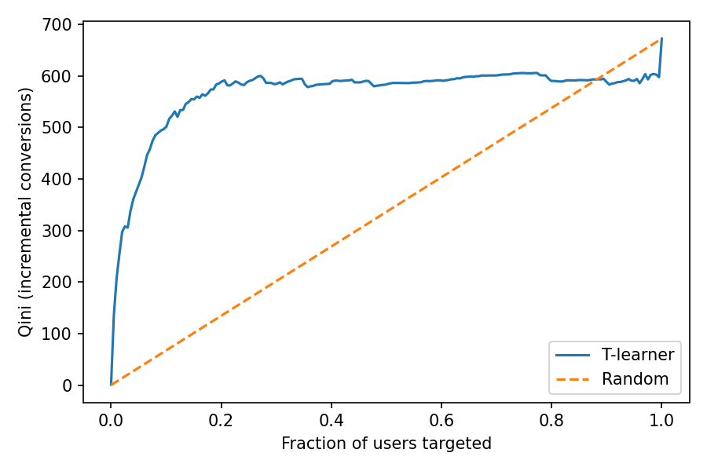

# Ad Incrementality A/B Test & Uplift Modeling (Criteo Uplift Dataset)

End-to-end analysis of a randomized advertising experiment: experiment health checks, effect estimation, variance reduction, uplift modeling, and a targeting-policy simulation.

## Data
[Criteo Uplift Prediction Dataset (v2.1)](https://ailab.criteo.com/criteo-uplift-prediction-dataset): ~14M users from randomized incrementality tests (treatment ≈ 85% / control ≈ 15%), 12 anonymized features, outcomes `visit` and `conversion`.
The raw file is not included (3.25 GB). This analysis uses a **random sample of ~2.1M rows** (15% of each 1M-row chunk, because the file is not shuffled).

## Methods
1. **Experiment health checks**: SRM test, standardized mean differences (covariate balance), power / sample-size analysis.
2. **Effect estimation**: two-proportion z-tests, bootstrap CIs, Holm correction across two metrics (conversion, visit).
3. **Variance reduction**: regression (covariate) adjustment. Not CUPED, since no pre-period outcome is available.
4. **Uplift modeling**: T-learner with XGBoost, evaluated on a held-out set with a Qini curve.
5. **Targeting simulation**: treat the top-k% of users by predicted uplift; compare incremental conversions and profit with blanket targeting.

## Key results
| Item | Result |
|---|---|
| Sample | 2,096,939 users (1,781,973 treated / 314,966 control) |
| SRM check (vs 85/15) | p = 0.41, passed |
| Conversion | 0.195% (control) → 0.312% (treated); relative lift **60.1%**, bootstrap 95% CI 48.0%–74.4%, p ≈ 5e-29 |
| Visit | 3.79% → 4.83%; relative lift **27.6%**, 95% CI 25.2%–30.0% |
| Covariate balance | max SMD = 0.050 (f3), below the 0.1 rule of thumb but larger than expected under pure randomization |
| Regression-adjusted conversion lift | **~42.8%** (CI ~5.7% narrower) |
| Uplift model | Top 10% of users capture ~74% and top 20% capture ~87% of incremental conversions (held-out set) |
| Policy simulation (assumed $50 per conversion, $0.02 per exposure) | Treating the top 20% yields ~34% higher profit than blanket targeting |



## Limitations
- Mild covariate imbalance (see above) may mean the unadjusted 60% lift is somewhat overstated; both estimates are reported. The cause was not investigated further.
- The dataset combines several incrementality tests; test identity is not available, so heterogeneity across tests is not modeled.
- Top-k uplift estimates are noisy because conversions are rare (~0.2%). The best-k in the simulation is chosen on the same held-out set, so it is optimistic; the fixed top-20% figure is more reliable.
- Value per conversion and cost per exposure are **assumptions**, not data.
- Analysis uses a sample, not the full 14M rows.

## Run it
```
pip install pandas numpy scipy statsmodels scikit-learn xgboost matplotlib
python criteo_ab_project.py criteo-uplift-v2.1.csv
```
Outputs are printed to the terminal; the Qini plot is saved to `figs/qini.png`. Full output from my run is in `results.txt`.
